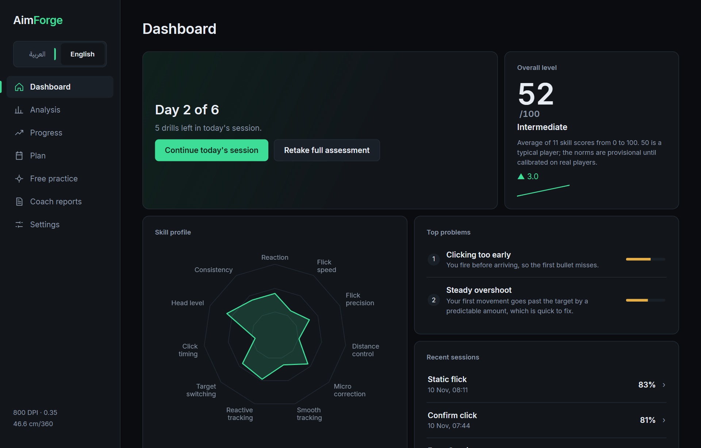
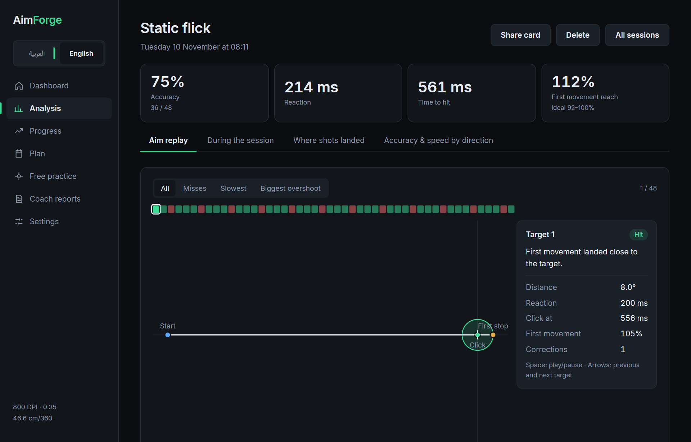
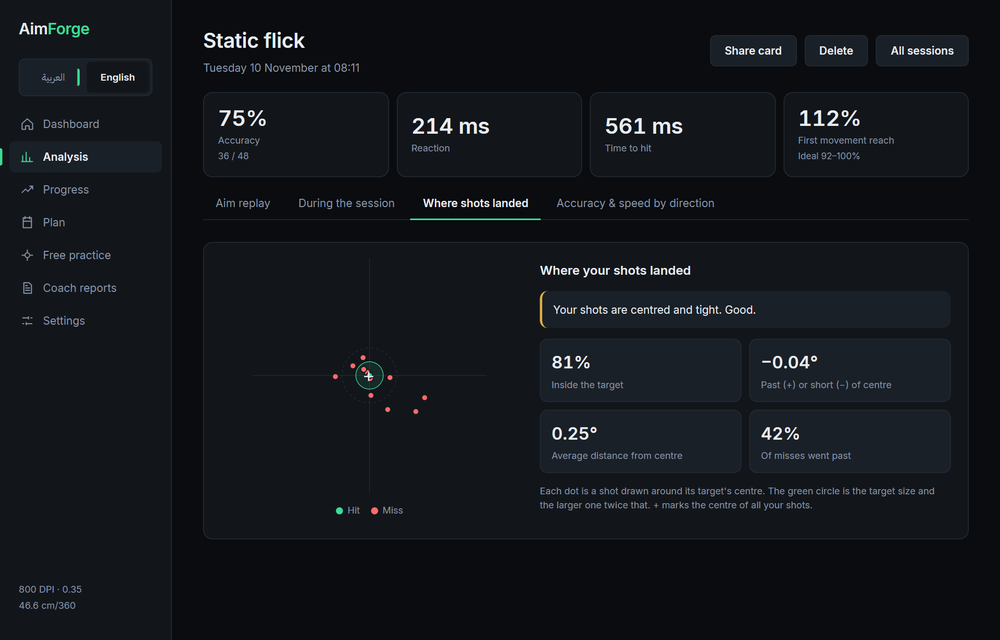
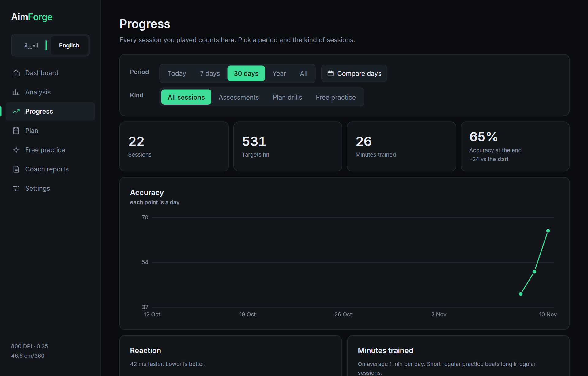
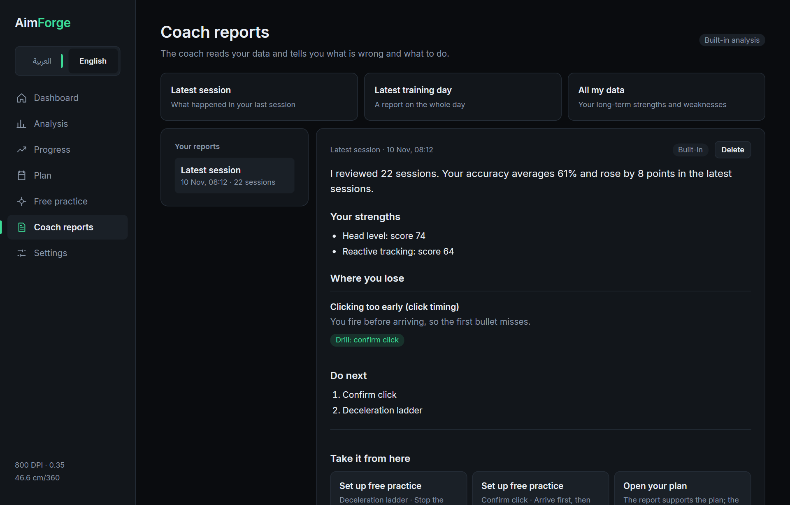

# AimForge

[](https://github.com/crrrowz/Custom-Aim-Trainer/actions/workflows/ci.yml)
[](https://github.com/crrrowz/Custom-Aim-Trainer/releases)
[](#license)

AimForge is a desktop aim trainer for VALORANT players that tries to answer two questions honestly:
**what exactly is wrong with my aim, and did practice actually fix it?**

Most aim trainers give you scenarios and a score. AimForge measures how you aim: the reaction before you
move, the first movement toward the target, the correction after it, and the click. It turns that into
a short plan, then retests you with a fresh but equivalent test and compares the skills you trained
against the ones you did not, so a better number from simply getting used to the test is not counted as
progress.



## Download

Get the Windows installer or the portable zip from the
[latest release](https://github.com/crrrowz/Custom-Aim-Trainer/releases), then follow the
[user guide](docs/USER_GUIDE.md). The builds are not code-signed yet, so SmartScreen may ask you to
confirm with **More info → Run anyway**.

> **Status: early alpha.** It runs on Windows only. The skill scores use provisional norms that have not
> yet been calibrated on real players, and the in-game movement values are not yet verified against
> VALORANT. Expect rough edges and breaking changes.

## How it works

1. **Assessment.** A warm-up and seven short tests (flicks, micro-precision, head-level peeks, smooth
   and strafe tracking, target switching, counter-strafe timing). An interrupted assessment continues
   from the first unfinished test.
2. **Diagnosis.** The recordings are analysed into skill scores from 0 to 100 with confidence ranges,
   and into concrete findings such as systematic overshoot or clicking before arrival.
3. **Plan.** Six days of about 16 minutes, focused on the top two findings. Each drill has a rule that
   trains the specific habit (for example, a hit that overshoots first does not count), and its
   difficulty adapts to your results.
4. **Retest.** The same tests in a new form. The result compares trained and untrained skills and
   decides whether to continue, switch drills, or move on.

<table>
  <tr>
    <td></td>
    <td></td>
  </tr>
  <tr>
    <td></td>
    <td></td>
  </tr>
</table>

Alongside the plan there is free practice (build your own session or open any drill from the
library), per-session analysis down to every flick, progress charts, and coach reports. Reports are
written offline by a built-in engine; you can optionally connect an AI provider (Claude, OpenAI,
Gemini, OpenRouter, or any OpenAI-compatible server) to rewrite them. Any AI answer is checked against
the measured numbers and falls back to the built-in report if it does not match.

The trainer deliberately has no 3D world: a plain patterned background, targets, and a crosshair. The
camera is a perspective camera matched to VALORANT's field of view and sensitivity, so angles and
distances mean the same thing as in the game.

## Architecture

```text
apps/desktop      Tauri 2 app: React + TypeScript UI, Rust backend that runs the trainer and
                  stores results in SQLite
apps/trainer      Bevy program that shows the targets, reads raw mouse input, and records each
                  session to a .aft file
crates/
  aim-core        Units, camera, sensitivity conversion, shared types
  aim-telemetry   The .aft recording format (postcard + zstd), versioned and frozen at v1
  aim-scenarios   Scenario schema and seeded generators: the same seed gives the same targets
  aim-analysis    Turns recordings into flicks, tracking error and skill scores (pure, no I/O)
  aim-coach       Findings, drills, plans and retest evaluation (pure, no I/O)
  aim-store       Local SQLite storage
  aim-llm         Optional AI rewriting of reports, with number checks and fallback
  aim-sync, aim-wasm   Placeholders for later cloud sync and browser analysis
tools/aft-dump    Command-line summary of a recording
content/          Scenarios, the assessment battery and analysis thresholds as RON data files
```

The desktop app starts the trainer as a separate process for each test and reads back the recordings
it writes. The analysis and coaching crates must not depend on Bevy, Tauri, windowing, networking or
the database; `scripts/check-boundaries.ps1` enforces this.

[`docs/ARCHITECTURE.md`](docs/ARCHITECTURE.md) explains how the pieces fit, with diagrams. More
detail, in Arabic, is in [`docs/platform/`](docs/platform/): architecture, the diagnosis engine,
the training loop, the data format, UI rules and session rules.

## Requirements for building

- Windows 10 or 11 (the trainer reads raw input through Win32).
- Rust stable with the `x86_64-pc-windows-msvc` target (pinned in `rust-toolchain.toml`) and the
  Visual Studio C++ build tools.
- Node.js and npm for the desktop UI.

## Run it from source

```powershell
powershell -ExecutionPolicy Bypass -File scripts\run-desktop.ps1
```

The script builds the trainer with the `play` profile, installs the UI packages on first run, and
starts the desktop app with `tauri dev`. Set `CARGO_TARGET_DIR` first if you want the build output in a
specific folder.

The trainer can also run on its own, for example:

```powershell
cargo run --profile play -p trainer -- --scenario assess.v1.flick_static --windowed
```

To work on the UI in a browser without the game, run `npm --prefix apps/desktop/ui run dev` and open
`http://localhost:1420`. Outside Tauri the UI uses built-in sample data.

## Development

Every change must pass the same checks CI runs:

```powershell
cargo fmt --all -- --check
cargo clippy --workspace --all-targets -- -D warnings
cargo test --workspace
.\scripts\check-boundaries.ps1
```

The desktop backend is a separate Cargo workspace: run `cargo clippy --all-targets -- -D warnings` and
`cargo test --lib` inside `apps/desktop/src-tauri`, and `npm run build` inside `apps/desktop/ui`.

To build the installer and the portable zip yourself, run
`powershell -ExecutionPolicy Bypass -File scripts\package-release.ps1`; the files land in `dist\`.

See [CONTRIBUTING.md](CONTRIBUTING.md) for the rules that keep recordings readable and measurements
comparable.

## Other folders

These are not part of the desktop app:

- `valorant-mcp-server/`: a Python MCP server for VALORANT match data (see its own README).
- `docs/roadmap/`: earlier planning notes, superseded by `docs/platform/`.

## Known limitations

- Windows only.
- Skill norms are provisional; scores are best read as change over time, not as a rank.
- Movement values for counter-strafe drills are provisional.
- API keys for AI providers are stored unencrypted in the app's local data folder.
- The installer and the app are not code-signed yet.

## License

Licensed under either of [Apache License, Version 2.0](LICENSE-APACHE) or [MIT license](LICENSE-MIT),
at your option. `valorant-mcp-server/` carries its own license.

AimForge is not affiliated with or endorsed by Riot Games. VALORANT is a trademark of Riot Games, Inc.
