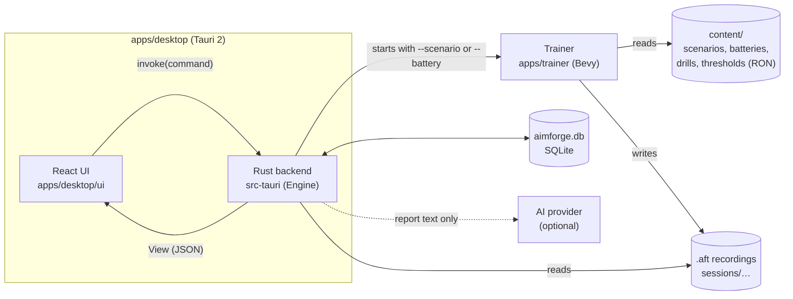

# Architecture

AimForge is two programs and a set of pure Rust libraries. The desktop app is what the player sees; the
trainer is the game window that shows targets and records the mouse. They talk through files: the app
starts the trainer with arguments, the trainer writes a recording, the app reads it back.

A more detailed design, in Arabic, is in [`platform/02_ARCHITECTURE.md`](platform/02_ARCHITECTURE.md).

## The pieces



| Part | Path | Job |
| --- | --- | --- |
| Desktop UI | `apps/desktop/ui` | React + TypeScript screens. Outside Tauri it runs on sample data (`src/mock.ts`). |
| Desktop backend | `apps/desktop/src-tauri` | `Engine` in `core.rs`: settings, starting the trainer, reading recordings, plans, reports. A separate Cargo workspace. |
| Trainer | `apps/trainer` | Bevy window with targets and a crosshair, Win32 raw mouse input, writes one `.aft` per session. |
| `aim-core` | `crates/aim-core` | Units, angles, camera and sensitivity conversion shared by everything. |
| `aim-telemetry` | `crates/aim-telemetry` | The `.aft` recording format: postcard + zstd, frozen at v1. |
| `aim-scenarios` | `crates/aim-scenarios` | Scenario schema and seeded generators: the same seed gives the same targets. |
| `aim-analysis` | `crates/aim-analysis` | Recording → flicks, tracking error, skill scores with confidence ranges. Pure. |
| `aim-coach` | `crates/aim-coach` | Findings, drills, six-day plans, retest decisions, the built-in report writer. Pure. |
| `aim-store` | `crates/aim-store` | SQLite storage of assessments, plans and reports. |
| `aim-llm` | `crates/aim-llm` | Optional AI rewrite of reports, with a check that every number matches the data. |
| `aft-dump` | `tools/aft-dump` | Prints a summary of a recording, for debugging. |

## One session, end to end

```mermaid
sequenceDiagram
  participant P as Player
  participant UI as Desktop UI
  participant E as Engine (backend)
  participant T as Trainer
  participant A as aim-analysis / aim-coach
  P->>UI: Start assessment
  UI->>E: invoke("run_assessment")
  E->>T: trainer.exe --battery … --output-dir sessions/run-…/
  T->>T: show targets, record raw input
  T-->>E: exits; .aft files written
  E->>A: analyse recordings
  A-->>E: skill profile, findings, plan
  E->>E: save to aimforge.db
  E-->>UI: new View
  UI-->>P: scores, problems, today's plan
```

The trainer runs as its own process for each test so that a crash or a closed window never loses the
app's state, and so the game loop gets a whole process with no web view beside it. An interrupted
assessment keeps its finished tests and continues from the first unfinished one.

## Rules the code enforces

- **Pure domain crates.** `aim-analysis` and `aim-coach` must not depend on Bevy, Tauri, windowing,
  networking or the database. `scripts/check-boundaries.ps1` fails the build if they do, and CI runs it.
- **Frozen recording format.** `.aft` v1 is postcard-encoded, so struct fields and enum variants in
  `crates/aim-telemetry/src/format.rs` are never reordered, renamed or removed. A golden fixture test
  guards this; new data goes in a new version.
- **Comparable measurements.** Scenarios carry a version. When a test changes, its version goes up and
  results across versions are not compared as progress.
- **No 3D world.** The trainer shows a plain background, targets and a crosshair, through a perspective
  camera matched to VALORANT's field of view and sensitivity, so degrees mean the same as in the game.

## Where data lives

| What | Where |
| --- | --- |
| Settings, assessments, plans, reports | `%APPDATA%\com.aimforge.desktop\aimforge.db` |
| Recordings | `%APPDATA%\com.aimforge.desktop\sessions\` |
| Coach data settings | `%APPDATA%\com.aimforge.desktop\coach_config.json` |
| Share cards | `%USERPROFILE%\Pictures\AimForge\` |

Nothing leaves the computer unless you choose an AI provider for reports; then only the numbers the
coach settings allow are sent, never the recordings.

## Releases

`scripts/package-release.ps1` builds the trainer and the desktop app in release mode and produces, in
`dist/`, an NSIS installer and a portable zip. Both hold the app, `trainer.exe` and the `content/` folder
side by side; the app finds the trainer and the content next to its own executable. Pushing a tag such
as `v0.1.0` runs `.github/workflows/release.yml`, which does the same on GitHub and attaches the files
to a draft release.
