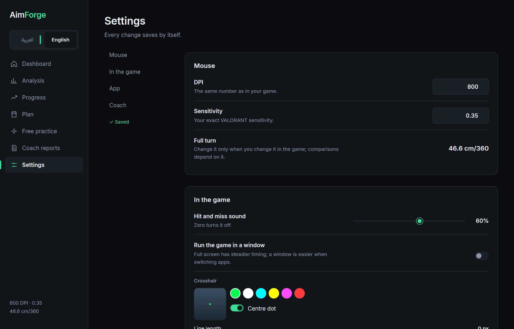
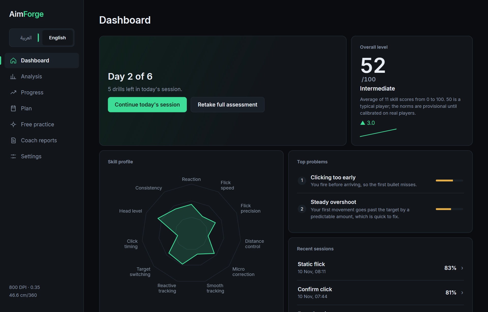
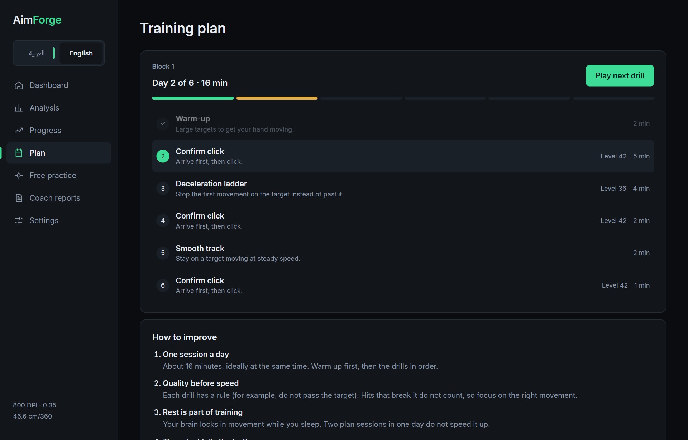
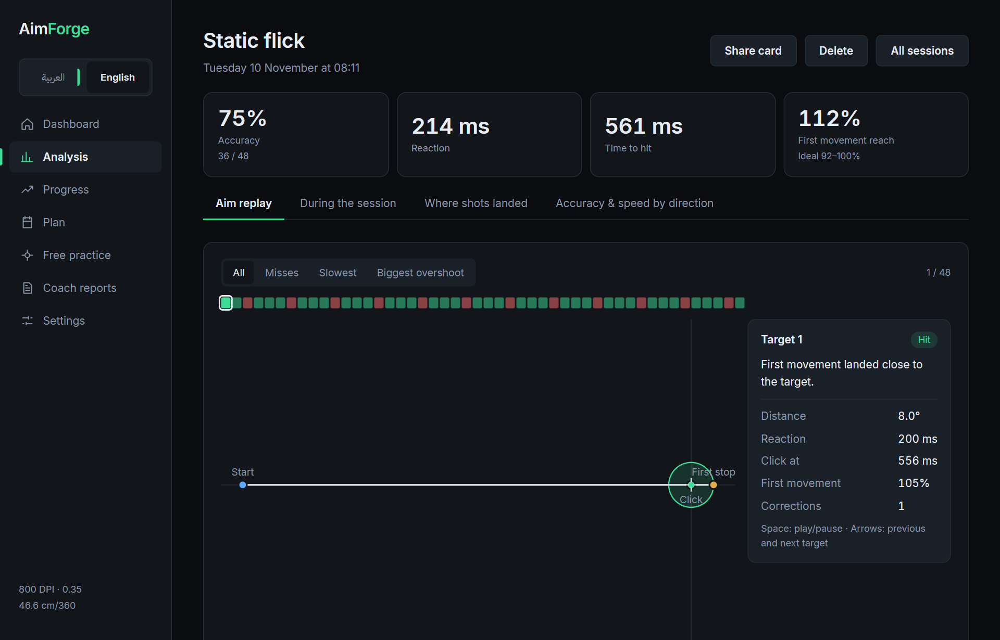
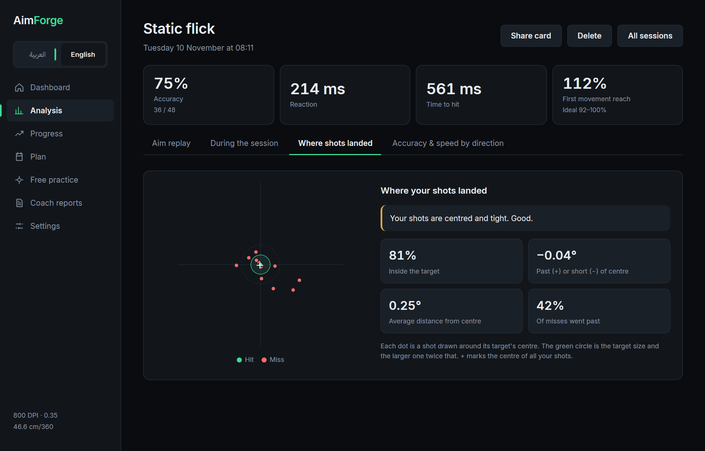
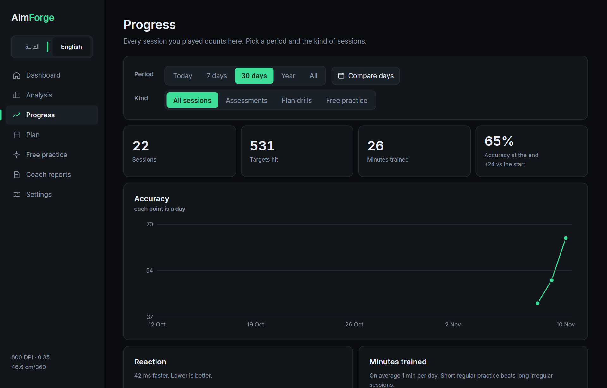
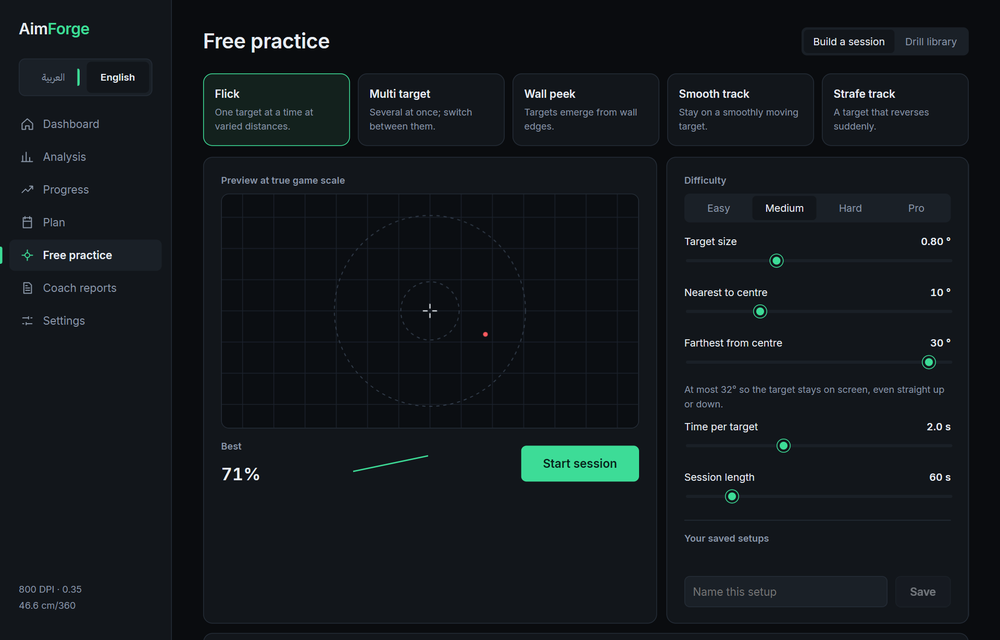
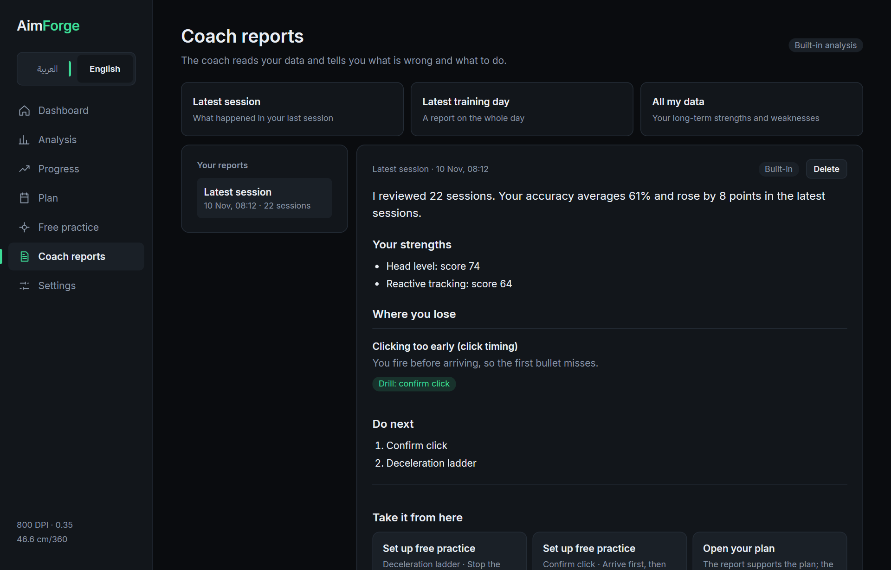
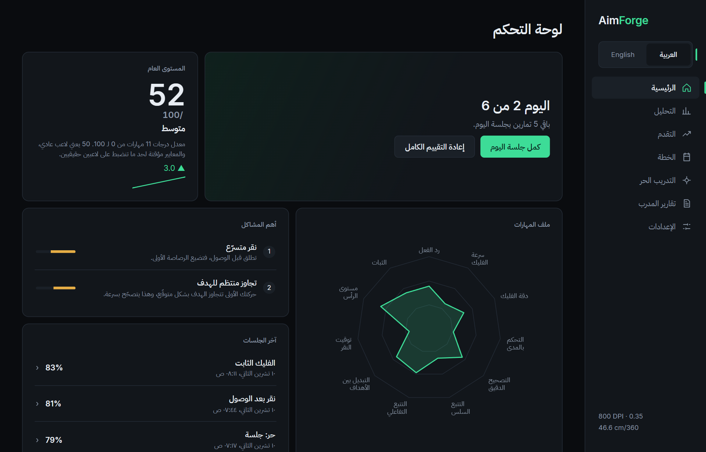

# User guide

## Install

Download the latest Windows build from the [Releases page](https://github.com/crrrowz/Custom-Aim-Trainer/releases):

- `AimForge-<version>-windows-x64-setup.exe` installs AimForge for your user (no admin rights) and adds
  a Start menu entry.
- `AimForge-<version>-windows-x64-portable.zip` runs without installing: unzip it anywhere and open
  `AimForge.exe`. Keep `trainer.exe` and the `content` folder next to it.

The builds are not code-signed yet, so Windows SmartScreen may warn on first run: choose
**More info → Run anyway**. You can check the download against `SHA256SUMS.txt` on the release page.
AimForge needs Windows 10 or 11 with the WebView2 runtime (built into Windows 11).

## First run

Enter the **DPI** of your mouse and your exact **VALORANT sensitivity**. AimForge uses them to turn
mouse movement into the same angles as in the game, and shows the result as cm per 360°. Change them
only when you change them in the game, because progress comparisons depend on them.

## The training loop

1. **Assessment.** A warm-up and seven short tests. Play them as you would in a
   match. If you stop part-way, the finished tests are kept and the next start continues from the
   first unfinished one.
2. **Dashboard.** Your skill profile (0 to 100 per skill, 50 is a typical player) and the two problems
   that cost you the most.

   

3. **Plan.** Six days of about 16 minutes, built around those problems. Each drill has a rule that
   trains the habit (for example, a hit that passes the target first does not count). Difficulty adapts
   to your results. Do one session a day; the plan waits for a rest day before the retest.

   

4. **Retest.** The same kinds of tests with new target positions. The result compares the skills you
   trained with the ones you did not, so getting used to the test is not counted as progress, and
   decides whether to continue, switch drills or move on.

## In the game window

- **Esc** pauses. From the pause menu you can resume, or **Quit & Save** to keep what you played so far.
- Switching away from the window pauses automatically.
- The top-left corner shows progress and feedback on the last shot.

## Looking at your sessions

**Analysis** lists every session. Open one to see:

- **Aim replay**: every target, played back with your real mouse path, where your first movement
  stopped and where you clicked. Play one target, or auto-play all of them.
- **During the session**: how speed and accuracy changed from start to end.
- **Where shots landed**: whether you tend to stop short, go past, or lean to one side.
- **By direction**: accuracy and speed for each of eight directions, with the weakest highlighted.

**Share card** saves a picture of the session to `Pictures\AimForge`.

## Progress

Accuracy, reaction and minutes trained over 7 days, 30 days, a year, or everything, filtered by the
kind of session. **Compare days** puts two days side by side.

## Free practice

Build your own session or open any drill from the library, outside the plan. Free practice sessions
show up in Analysis and Progress like any other.

## Coach reports

A report on your latest session, your latest training day, or all your data: strengths, where you
lose, and what to do next. Reports are written offline by the built-in analysis. In **Settings →
Coach** you can choose an AI provider (Claude, OpenAI, Gemini, OpenRouter, or any OpenAI-compatible
server such as a local model) to rewrite them. You choose what data the coach may see; recordings are
never sent. If the AI answer contains a number that is not in your data, the built-in report is used.

## Your data

Everything is stored on your computer in `%APPDATA%\com.aimforge.desktop`: the database
(`aimforge.db`), the recordings (`sessions\`) and the coach settings (`coach_config.json`). API keys
for AI providers are stored there unencrypted. Uninstalling the app does not delete this folder;
delete it yourself to remove all data.

## Language

Switch between Arabic and English at any time from the top of the side menu.

